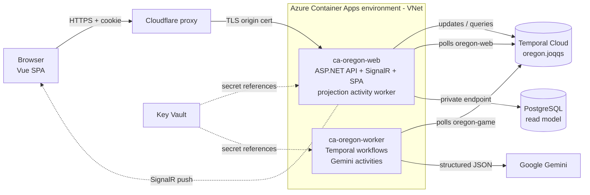

# STARWAGON: the long haul to the Oregon Reach

[](https://github.com/biffkittz/operation-oregon-trail/actions/workflows/ci.yml)

A retro, text-heavy, single-player game. You captain a patched-up "starwagon" across a hostile frontier toward
Willamette Landing: the optimism of a spacefaring commonwealth meets the dust, debt and dysfunction of a wagon
trail. Every voyage is a **durable Temporal workflow**; an LLM (**Google Gemini**) writes the world, plays the
other characters and **judges your free-text answers**, while deterministic C# rules decide the consequences.

| | |
|---|---|
| **Frontend** | Vue 3 + TypeScript + Vite + Tailwind CSS v4 + Pinia + SignalR client (`app/frontend`) |
| **Backend** | ASP.NET Core (.NET 10): JSON API, SignalR hub, serves the SPA, owns the Postgres read model (`app/backend`) |
| **Worker** | .NET 10 Temporal worker: game workflows and Gemini activities (`worker/`), released independently |
| **Contracts** | Temporal workflow interfaces and DTOs shared by backend and worker (`shared/Oregon.Contracts`) |
| **Infrastructure** | Terraform for Azure Container Apps, PostgreSQL, Key Vault and Cloudflare DNS (`infra/`) |
| **Production** | https://oregon.biffkittz.com, Temporal Cloud namespace `oregon.joqqs` |

## Quick start (WSL Ubuntu + VS Code)

```bash
# one-time: install the tools listed in docs/development-setup.md, then
dotnet tool restore
(cd app/frontend && npm ci)

# build the SPA + backend, combine them, start Postgres/Temporal and the worker, run the site
./buildAndRunSite.sh
```

Open http://localhost:5069 and log in with the development password `oregon`. Without a Gemini key the worker
uses an offline fake LLM; to play with Gemini, store your key once:

```bash
dotnet user-secrets set "Llm:Gemini:ApiKey" "<your-key>" --project worker/Oregon.Worker
```

Temporal's Web UI (http://localhost:8233) shows every voyage as a workflow, including its full event history.

## How it fits together



* A player command is a Temporal **Update**: validated by the workflow, processed by its main loop (which may call
  Gemini through activities), and answered with the new game view.
* The workflow **projects** each new state through an activity hosted by the backend (task queue `oregon-web`),
  which writes the Postgres read model (save slots, journal) and pushes the view to the browser over SignalR.
* Timers (answer deadlines, real-time repairs) are durable workflow timers: they fire even if nobody is online.

## Documentation

| Document | What's in it |
|---|---|
| [docs/development-setup.md](docs/development-setup.md) | Installing the toolchain on WSL Ubuntu, VS Code extensions, running and debugging locally, tests |
| [docs/build-and-deploy.md](docs/build-and-deploy.md) | Building each project, container images, first Azure deployment, releases, secrets rotation |
| [docs/architecture.md](docs/architecture.md) | Components, data flow, Temporal design, LLM integration, security model, design decisions |
| [docs/game-design.md](docs/game-design.md) | Setting, game loop, stats, encounters, difficulty and balance |
| [infra/README.md](infra/README.md) | Terraform layout, variables, outputs |
| `CLAUDE.md` files | Conventions and gotchas per project (root, `app/frontend`, `app/backend`, `worker`, `infra`) |

## Repository layout

```
app/
  frontend/             Vue 3 SPA (Vite, Tailwind, Pinia, Vitest, Playwright)
  backend/              ASP.NET Core backend (Oregon.Backend)
  backend.Tests/        API integration tests (Testcontainers PostgreSQL)
  Dockerfile            web image: SPA + backend in one container
worker/
  Oregon.Worker/        Temporal worker: workflows, game rules, Gemini client
  Oregon.Worker.Tests/  rules, director playthroughs, balance, workflow integration tests
  Dockerfile            worker image
shared/Oregon.Contracts Temporal contracts shared by backend and worker
infra/                  Terraform (root module, modules/, environments/)
scripts/                dev-deps.sh, release-web.sh, release-worker.sh
docs/                   documentation
buildAndRunSite.sh      build + combine + run locally
compose.yaml            local PostgreSQL (and optional Temporal dev server)
oregon.slnx             .NET solution
oregon.code-workspace   VS Code multi-root workspace
```
