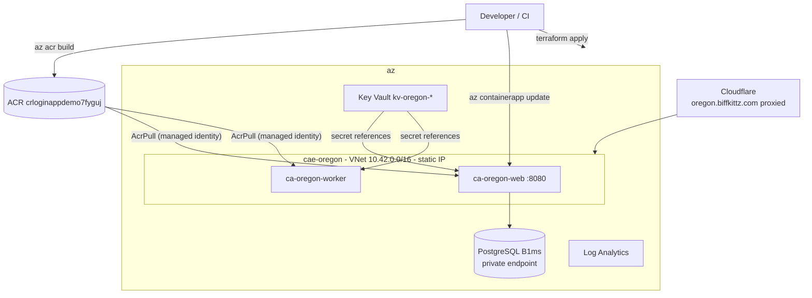

# Build and deploy

Two deployables, each with its own build and release path:

| Deployable | Source | Image | Container App | Release script |
|---|---|---|---|---|
| **web**: Vue SPA + ASP.NET backend (+ projection activity worker) | `app/frontend`, `app/backend`, `shared/` | `oregon-web` (`app/Dockerfile`) | `ca-oregon-web` | `scripts/release-web.sh` |
| **worker**: Temporal workflows + Gemini activities | `worker/Oregon.Worker`, `shared/` | `oregon-worker` (`worker/Dockerfile`) | `ca-oregon-worker` | `scripts/release-worker.sh` |

Images live in the existing registry **`crloginappdemo7fyguj.azurecr.io`** (resource group `rg-loginapp-demo`).
Everything else is created by Terraform in **`rg-oregon`** (`eastus2`, near the Temporal Cloud namespace
`oregon.joqqs` in AWS `us-east-2`). The PostgreSQL server alone lives in `centralus` (`postgres_location`), reached
through a private endpoint in the `eastus2` VNet.



## 1. Building locally

| What | Command | Output |
|---|---|---|
| Frontend | `cd app/frontend && npm ci && npm run build` | `app/frontend/dist` (type-checked, hashed assets) |
| Backend | `dotnet publish app/backend/Oregon.Backend.csproj -c Release -o artifacts/site` | serve the SPA by copying `dist` into `app/backend/wwwroot` first |
| Worker | `dotnet publish worker/Oregon.Worker/Oregon.Worker.csproj -c Release -o artifacts/worker` | |
| Everything, combined and running | `./buildAndRunSite.sh` | see [development-setup.md](development-setup.md) |
| Web image | `docker build -f app/Dockerfile -t oregon-web .` | SPA built in a Node stage, baked into the backend's `wwwroot` |
| Worker image | `docker build -f worker/Dockerfile -t oregon-worker .` | |

Image notes:

* Both builds use the **repository root** as context. `.dockerignore` excludes `infra/`, every `.secrets/`
  folder, `scratch`, certificates and `.env` files, so secrets can never enter an image or be uploaded by
  `az acr build`.
* Runtime images are **chiseled Ubuntu** (`aspnet:10.0-noble-chiseled`, `runtime:10.0-noble-chiseled`): no
  shell, no package manager, non-root user. Use `az containerapp logs show`, not `exec`, to inspect them.
* Publishes are architecture-specific (`linux-x64` by default, `linux-arm64` on ARM builders) so only one copy of
  the Temporal SDK's native core is shipped. The sizes are about 245 MB (web) and 194 MB (worker).
* .NET builds treat warnings as errors and enforce `.editorconfig` style, in Docker too.

## 2. One-time Azure preparation

1. **Sign in** with the Linux Azure CLI: `az login`, then `az account set --subscription <id>`.
2. **Permissions**: the operator needs to create resources and role assignments in the subscription (Owner, or
   Contributor + User Access Administrator), including an `AcrPull` assignment on the shared registry.
3. **Resource providers** (once per subscription; Terraform does not auto-register them):

   ```bash
   for ns in Microsoft.App Microsoft.OperationalInsights Microsoft.DBforPostgreSQL Microsoft.KeyVault \
             Microsoft.Network Microsoft.ManagedIdentity Microsoft.ContainerRegistry; do
     az provider register --namespace "$ns"
   done
   ```

4. **Secrets file**: copy the template and fill it in. The file is ignored by git and Docker.

   ```bash
   cp infra/secrets.env.example infra/.secrets/secrets.env
   chmod 600 infra/.secrets/secrets.env
   $EDITOR infra/.secrets/secrets.env
   ```

   | Variable | Value |
   |---|---|
   | `ARM_SUBSCRIPTION_ID` | `az account show --query id -o tsv` |
   | `CLOUDFLARE_API_TOKEN` | token with *Zone:Read* and *DNS:Edit* on `biffkittz.com` |
   | `TF_VAR_app_login_password` | the site password players will type (choose a long one) |
   | `TF_VAR_gemini_api_key` | Google Gemini API key |
   | `TF_VAR_temporal_api_key` | Temporal Cloud API key with access to `oregon.joqqs` (prefer a service-account key) |
   | `TF_VAR_origin_certificate_password` | password of `infra/.secrets/biffkittz-origin.pfx` |

5. **Cloudflare zone settings** (zone-wide: they affect every hostname in `biffkittz.com`):
   * SSL/TLS mode **Full (strict)** (dashboard; already set; required because the origin presents the Cloudflare
     Origin CA certificate).
   * WebSockets **On** (dashboard; already on; SignalR needs it).
   * **Minimum TLS Version 1.2** (Terraform, `cloudflare_min_tls_version`; TLS 1.3 stays on). The Cloudflare token
     needs **Zone Settings: Edit** on the zone for this, in addition to Zone: Read and DNS: Edit.
   * Recommended: **Always Use HTTPS** on (dashboard; currently at its default).

## 3. First deployment

The Container Apps are created with images that must already exist, so images go first:

```bash
# 1) Build and push both images (tags :<git-sha> and :latest). --build-only: the apps don't exist yet.
scripts/release-web.sh --build-only
scripts/release-worker.sh --build-only

# 2) Create the infrastructure.
cd infra
source .secrets/secrets.env
terraform init
terraform plan  -var-file=environments/prod.tfvars
terraform apply -var-file=environments/prod.tfvars
```

`terraform apply` takes roughly 15-25 minutes (the VNet-integrated environment and PostgreSQL are the slow
parts). It creates the resource group, VNet and subnets, private DNS, Log Analytics, three managed identities (web,
worker, migrate job) with `AcrPull`, Key Vault with its secrets, the `data-protection` key and per-secret/per-key
RBAC, PostgreSQL B1ms with a private endpoint, the Container Apps environment, the origin certificate, both apps,
the migrate job, the Cloudflare DNS records and zone settings, and the custom-domain binding.

> **If the first apply fails with a 403 on a Key Vault secret**, Azure RBAC was still propagating the
> operator's role assignment. Wait a minute and run `terraform apply` again. This is safe: the PostgreSQL password
> is generated once, stored in Key Vault, and re-read from there on every run.

Verify:

```bash
terraform output
curl -fsS https://oregon.biffkittz.com/healthz/ready     # "Healthy"
```

Then create the schema and the app's database role, and roll the web app onto the new image:

```bash
scripts/release-web.sh      # runs the migrate job (schema + oregon_app role) before rolling out the web app
```

The web app connects as the least-privilege `oregon_app` role and never runs migrations; until the migrate job has
run once, its readiness check fails because the role doesn't exist yet. Then open https://oregon.biffkittz.com and
log in with `TF_VAR_app_login_password`.

## 4. Releasing changes

Release a committed, pushed commit with one command:

```bash
scripts/deploy.sh                       # everything: worker + web
scripts/deploy.sh --target web          # or just one (worker | web)
scripts/deploy.sh --ref origin/main     # deploy what's on GitHub, from a clean temporary checkout
scripts/deploy.sh --infra               # also terraform plan/apply (asks before applying)
scripts/deploy.sh --dry-run             # checks + the plan, changes nothing
```

It refuses to start unless the Linux Azure CLI is logged in and the source is a clean commit that is on a remote
branch (so the image tag is that commit's SHA and maps to GitHub). Then, in this order:

1. **builds** the images (`az acr build`, or `--local` Docker) tagged `:<sha>` (and `:latest`);
2. **migrates** with the new web image (`job-oregon-migrate`) while the old revisions keep serving;
3. **applies Terraform** if `--infra` (after the migration, so new app settings find the schema and roles they need);
4. **rolls out** the worker, then the web app, waiting for each revision to run;
5. **smoke-tests** the site through Cloudflare (`scripts/smoke-test.sh`): readiness, login, a voyage is created,
   gets its LLM prologue and journal, and is deleted again. Login needs `SMOKE_PASSWORD` or
   `TF_VAR_app_login_password` (sourced from `infra/.secrets/secrets.env`); without it only health is checked;
6. **rolls back** to the previous images if a rollout or the smoke test fails, and says so. Migrations are not rolled
   back, which is why they must stay backward compatible.

`scripts/release-web.sh` and `scripts/release-worker.sh` still release a single app (they allow `-dirty` tags, with
a warning) for quick experiments; `scripts/smoke-test.sh` runs the smoke test on its own.

### Clean commits, clean tags

A tag ends in `-dirty` when `git status --porcelain` isn't empty: uncommitted edits, untracked files that aren't
ignored, **or mode-only changes**. The image then doesn't correspond to any commit, so `deploy.sh` refuses it.

| `git status` shows | Cause | Fix |
|---|---|---|
| `M file` with `old mode 100644 new mode 100755` in `git diff` | a commit made from a Windows git client (e.g. GitKraken on Windows) dropped the executable bit: it sees WSL files without Linux permissions and commits them as 100644 | once per clone: `git config core.fileMode false` (git then ignores the bit on disk and keeps the recorded one); then `git add --chmod=+x <file>` and commit. New scripts always need `--chmod=+x`; CI fails if one is missing |
| ` M` on files you didn't edit, diff is all line endings | CRLF written by a Windows tool | `.gitattributes` forces LF; `git add --renormalize .` and commit |
| `??` new files | not committed yet | commit them, or add them to `.gitignore` |
| your own work in progress | not ready to release | `git stash -u`, deploy, `git stash pop`; or `scripts/deploy.sh --ref origin/main` |

Recommended habit: commit from WSL (terminal or VS Code connected to WSL), keep `core.fileMode=true` in this
clone, push, then deploy. If you also use a Windows git client on the same files, make it read the repository
through `\\wsl$\...` rather than a copy on the Windows drive.

### Azure CLI in WSL

Use the Linux Azure CLI (`command -v az` must print `/usr/bin/az`), with **its own** profile. If `~/.azure` is a
symlink to the Windows profile (`/mnt/c/Users/<you>/.azure`), both CLIs share extensions and break each other
(seen here: an unreadable `log-analytics` extension made every command fail in both). Fix once:

```bash
rm ~/.azure    # only removes the symlink; the Windows profile is untouched
az login
```

**Database migrations** run in the Container Apps job `job-oregon-migrate` (the web image with the `migrate`
argument), as the database admin, *before* the web rollout: `release-web.sh` calls `scripts/migrate-db.sh` with the
new image and stops if it fails. The job applies EF Core migrations, creates/updates the `oregon_app` role (data
access only; no CREATE/ALTER/DROP/TRUNCATE; its password is sent as a SCRAM verifier) and deletes session keys that
predate Key Vault encryption. Run it alone with `scripts/migrate-db.sh [--tag <tag>]`. Migrations must stay
backward compatible with the running web revision (add columns/tables first, remove them a release later).

Terraform ignores the image of both apps (`lifecycle.ignore_changes`), so `terraform apply` never rolls back a
release. **Manual rollback** (deploy.sh prints the previous images): `az containerapp update -n ca-oregon-web -g
rg-oregon --image crloginappdemo7fyguj.azurecr.io/oregon-web:<previous-sha>` (same for the worker). Rolling the
worker back after games advanced on a new `Workflow.Patched` branch stalls those games (Temporal retries their tasks)
until the fix is rolled forward; nothing is lost.

Release order when contracts change (`shared/Oregon.Contracts`): make changes additive (new optional fields,
new updates), release the **worker first**, then the web app. Never rename workflow or activity names.

## 4a. Continuous integration and deploying from GitHub

**CI** (`.github/workflows/ci.yml`) runs on every push to `main`, every pull request and on demand. Its jobs run in
parallel and all must pass:

| Job | What it checks |
|---|---|
| `.NET` | restore, known-vulnerable NuGet packages, Release build (warnings are errors, style enforced), all 162+ tests incl. Testcontainers PostgreSQL, a Temporal dev server and the replay tests |
| `Frontend` | `npm ci`, `npm run check` (vue-tsc, ESLint, oxlint, Vitest), production build, `npm audit --omit=dev` |
| `End-to-end` | `./buildAndRunSite.sh` (Docker PostgreSQL + Temporal, fake LLM), then Playwright + axe; report and logs uploaded on failure |
| `Terraform` | `fmt -check`, `init -backend=false` with the committed lock file, `validate` (no credentials needed) |
| `ShellCheck + actionlint` | every script and workflow |
| `Docker images` | both Dockerfiles build (nothing is pushed) |

Actions are pinned to commit SHAs; update them deliberately (Dependabot can do it: `package-ecosystem:
github-actions`). Recommended: protect `main` and require the CI checks before merging.

**Deploy** (`.github/workflows/deploy.yml`) is manual: Actions > Deploy > Run workflow, choose `all`, `worker` or
`web`. It runs the full CI first, then (from `main` only, in the `production` environment) signs in to Azure with
**OIDC** and runs the same `scripts/deploy.sh` as a local release (`--local` builds on the runner): migrate, worker,
web, smoke test, automatic rollback. Add an environment secret `SMOKE_PASSWORD` (the site password) to include the
login and voyage round trip in the smoke test; without it only health is checked. Infrastructure changes
(`terraform apply`) stay a local, reviewed step.

One-time setup:

1. `github_repository = "biffkittz/operation-oregon-trail"` is set in `prod.tfvars`; `terraform apply` creates the
   `id-oregon-github` identity, its federated credential (trusting only runs of that repository in environment
   `production`) and a custom role "Oregon releaser" that can update the apps and the migrate job and assign their
   identities, plus AcrPush/Reader on the registry. It cannot read Key Vault, touch the database or change
   infrastructure.
2. `terraform output github_deploy` prints three values; add them as **repository variables** (Settings > Secrets
   and variables > Actions > Variables; they aren't secrets): `AZURE_CLIENT_ID`, `AZURE_TENANT_ID`,
   `AZURE_SUBSCRIPTION_ID`.
3. Create the **environment** `production` (Settings > Environments). Add yourself as a required reviewer if every
   release should wait for approval, and restrict it to the `main` branch.

## 5. Workflow code is long-lived: change it carefully

Every save slot is a running workflow that may live for weeks. When a new worker starts, Temporal replays each
workflow's history through the new code; if the new code makes different decisions for the same history, that
save fails with a *non-determinism* error. Mitigations already built in:

* The workflow **continues-as-new at every leg boundary**, so histories are short and new code takes over each
  save within one leg.
* Carried-over state has a **schema version** (`GameState.CurrentSchemaVersion`) with an upgrade hook in
  `GameStateSerializer`.

Before releasing changes to workflow code or game rules, follow the checklist in
[worker/CLAUDE.md](../worker/CLAUDE.md) (use `Workflow.Patched` for behavioral changes mid-leg).

## 6. Secrets and rotation

All secret values reach Key Vault through **write-only** attributes: they are never stored in Terraform state or
plan files. Apps read them through Container Apps **Key Vault references** with their own identity (the web app
can read the login password, database connection string and Temporal key; the worker only the Temporal and
Gemini keys).

| Rotate | How |
|---|---|
| Login password, Gemini key, Temporal key | update `infra/.secrets/secrets.env`, bump `secret_values_version`, `terraform apply`, then restart: `az containerapp revision restart -n <app> -g rg-oregon --revision <name>` |
| PostgreSQL passwords (admin and `oregon_app`) | bump `postgres_password_version` and apply (server, both passwords and both connection strings change together), run `scripts/migrate-db.sh` (sets the new app-role password), then restart the web app |
| Origin-pull client certificate | `scripts/cloudflare-origin-pull.sh --rotate`, put the new thumbprint in `origin_pull_certificate_sha256`, apply. Cloudflare switches to the newest active certificate, so expect a minute of 403s between the switch and the apply; delete the old certificate in Cloudflare afterwards |
| Data Protection key (`data-protection` in Key Vault) | rotate the key in Key Vault; existing key rings still unwrap with the old version |
| Origin certificate | replace the PFX, bump `origin_certificate_version`, apply |

Data Protection keys (which sign and encrypt the session cookies) are stored in PostgreSQL, wrapped with the Key
Vault key `data-protection`, so sessions survive restarts and new revisions but a database read alone can't forge
one. **Sessions end when the login password changes**: the cookie carries a keyed fingerprint of the password that
is checked on every request (restarting alone does not log anyone out).

### Hardening switches

* **Least-privilege database role**: the web app connects as `oregon_app` (Key Vault `postgres-app-connection-string`);
  only the migrate job's identity can read `postgres-admin-connection-string`.
* **Failed-login brake**: besides 5 attempts/minute per IP, all sign-ins are refused for the rest of the minute once
  `Auth:MaxFailedLoginsPerMinute` (default 30) failures have happened site-wide.
* **Cloudflare Authenticated Origin Pulls with our own certificate**: the ingress allow-list admits every Cloudflare
  customer, so Cloudflare presents a client certificate only our zone has, the ingress requires a client
  certificate, and the app checks its SHA-256 thumbprint (`/healthz` is exempt for platform probes). To enable:
  1. Give the Cloudflare token **SSL and Certificates: Edit** on the zone.
  2. `source infra/.secrets/secrets.env && scripts/cloudflare-origin-pull.sh` (generates the certificate in
     `infra/.secrets/origin-pull/`, uploads it, waits until it's active, prints the thumbprint).
  3. Release the web app (the image must contain the thumbprint check), then set
     `origin_pull_certificate_sha256` in `infra/environments/prod.tfvars` and apply. Terraform enables Authenticated
     Origin Pulls in Cloudflare before the ingress starts requiring a certificate.
  4. Check: `curl -s -o /dev/null -w '%{http_code}' https://oregon.biffkittz.com/api/auth/session` returns 200
     through Cloudflare; requests to the static IP or the default `*.azurecontainerapps.io` host fail.

## 7. Observing production

* Live logs: `az containerapp logs show -n ca-oregon-web -g rg-oregon --follow` (or `ca-oregon-worker`).
* Log Analytics (`log-oregon`): table `ContainerAppConsoleLogs_CL`; logs are JSON. Gemini latency and token usage
  are logged per call; judgments are logged with verdict and score.
* Temporal Cloud UI: https://oregon.joqqs.web.tmprl.cloud. Each save is workflow `oregon-game-<gameId>`, and its
  history shows every command, timer, LLM call and projection.
* Health: `/healthz/live` (liveness) and `/healthz/ready` (database + Temporal, used by the readiness probe).

## 8. Costs and teardown

Approximate monthly cost for this demonstration setup: two always-on 0.5 vCPU / 1 GiB Consumption replicas, a
B1ms PostgreSQL with 32 GiB, a private endpoint, Key Vault and a little Log Analytics. Check the Azure pricing
calculator for current numbers. Temporal Cloud and Gemini are billed separately.

`cd infra && source .secrets/secrets.env && terraform destroy -var-file=environments/prod.tfvars` removes
everything Terraform created, including the Cloudflare records (the Key Vault is purged on destroy). Images stay
in the shared registry.

## 9. Next steps

* **Replay tests in CI**: export a few production histories (`temporal workflow show --output json`) and replay
  them against new worker builds with `WorkflowReplayer` before releasing.
* **Scale-out**: more than one web replica would need a SignalR backplane (Azure SignalR Service or Redis) and a
  shared store for the failed-login brake (it is per replica).
