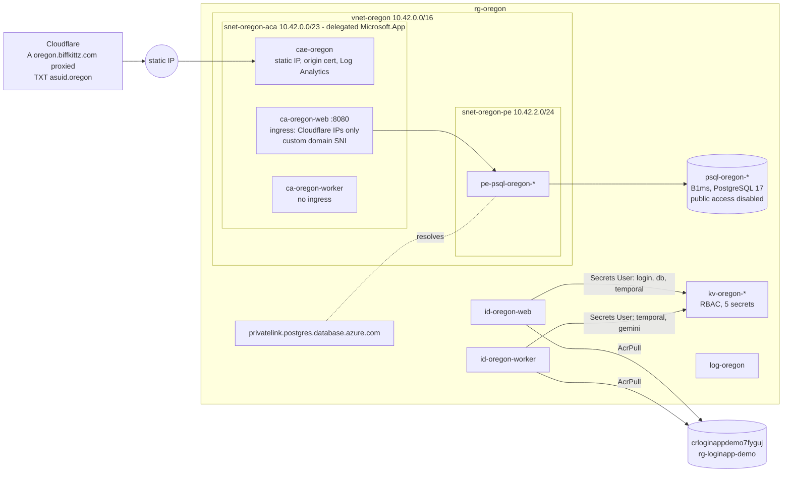

# infra: Terraform for STARWAGON on Azure Container Apps

Creates everything the game needs in **`rg-oregon`** (`eastus2`), reusing the existing container registry
`crloginappdemo7fyguj`. Every resource is tagged `project = oregon`. See
[../docs/build-and-deploy.md](../docs/build-and-deploy.md) for the end-to-end deployment procedure.



## Layout

| File / folder | Contents |
|---|---|
| `backend.tf` | Remote state in `rg-terraform-state` / `demonstration` / `terraform` / `oregon.terraform.tfstate` |
| `versions.tf` | Terraform >= 1.11; providers `azurerm ~> 5.14`, `azapi ~> 2.13`, `cloudflare ~> 5.29`, `random ~> 3.9` |
| `providers.tf` | Provider configuration (Key Vault purge on destroy, no automatic resource-provider registration) |
| `main.tf` | Resource group, identities, Key Vault and secrets, environment, certificate, apps, DNS, custom domain |
| `variables.tf`, `locals.tf`, `outputs.tf` | Inputs, naming and tags, outputs |
| `environments/prod.tfvars` | Non-secret settings for this environment |
| `secrets.env.example` | Template for `.secrets/secrets.env` (secret `TF_VAR_*`, Cloudflare token, subscription) |
| `modules/network` | VNet, delegated Container Apps subnet, private-endpoint subnet, private DNS zone and link |
| `modules/postgres` | Flexible server (B1ms), database, private endpoint with DNS zone group |
| `modules/container_app` | One Container App: identity, ACR pull, Key Vault references, optional ingress (IP allow-list) and probes. Used twice. |
| `modules/cloudflare_dns` | Verification TXT and proxied A record |

## Usage

```bash
cd infra
source .secrets/secrets.env               # see secrets.env.example
terraform init                             # az login first; state lives in Azure Storage
terraform fmt -check -recursive && terraform validate
terraform plan  -var-file=environments/prod.tfvars
terraform apply -var-file=environments/prod.tfvars
```

Images must exist in the registry before the first apply (`scripts/release-web.sh --build-only` and
`scripts/release-worker.sh --build-only`). After that, releases change images outside Terraform, which ignores
them on purpose.

A second `apply` with no changes must report **no changes**. Every resource is idempotent, and write-only values
are only re-sent when their `*_version` variable changes.

## Design notes

* **No secrets in state.** Secret inputs are `ephemeral` variables written through write-only attributes
  (`value_wo`, `administrator_password_wo`, azapi `sensitive_body`). The PostgreSQL password is generated by an
  ephemeral `random_password`, stored in Key Vault once per `postgres_password_version`, and read back with the
  ephemeral `azurerm_key_vault_secret`, so Key Vault stays the single source of truth across partial failures.
* **azapi for the certificate.** `azurerm_container_app_environment_certificate` would store the PFX and its
  password in state. `azapi_resource` with `sensitive_body` keeps both out. This is the only use of azapi.
* **TLS at the ingress.** Cloudflare (SSL mode Full (strict)) connects to the environment's static IP; the
  Container Apps ingress presents the Cloudflare Origin CA certificate for `oregon.biffkittz.com` (SNI binding) and
  forwards plain HTTP to the container on port 8080.
* **Cloudflare-only ingress.** `ingress_allowed_cidrs` defaults to Cloudflare's published IPv4 ranges. Update it if
  Cloudflare publishes changes (https://www.cloudflare.com/ips-v4).
* **Least privilege.** Separate user-assigned identities per app, `Key Vault Secrets User` granted per secret
  (not per vault), and the operator gets `Key Vault Secrets Officer` only on this vault.
* **Private database.** Public network access disabled; the app reaches the server through a private endpoint, and
  `privatelink.postgres.database.azure.com` makes the public FQDN resolve privately inside the VNet.
* **Single replica.** Both apps run exactly one replica (`min = max = 1`), as requested for this demonstration.

## Inputs

| Name | Description | Default |
|---|---|---|
| `subscription_id` | Azure subscription; null uses `ARM_SUBSCRIPTION_ID` | `null` |
| `location` | Azure region | `eastus2` |
| `resource_group_name` | Resource group | `rg-oregon` |
| `name_prefix` | Prefix for resource names | `oregon` |
| `extra_tags` | Additional tags (`project = oregon` is always applied) | `{}` |
| `deployer_principal_type` | `User`, `ServicePrincipal` or `Group` running Terraform | `User` |
| `vnet_address_space` | VNet CIDR | `10.42.0.0/16` |
| `container_apps_subnet_prefix` | Container Apps subnet (min /27) | `10.42.0.0/23` |
| `private_endpoints_subnet_prefix` | Private endpoint subnet | `10.42.2.0/24` |
| `container_registry_name` | Existing ACR | `crloginappdemo7fyguj` |
| `container_registry_resource_group` | ACR resource group | `rg-loginapp-demo` |
| `web_image_repository` / `worker_image_repository` | Image repositories | `oregon-web` / `oregon-worker` |
| `initial_image_tag` | Tag used when the apps are first created | `latest` |
| `web_cpu`, `web_memory`, `worker_cpu`, `worker_memory` | Container sizes | `0.5`, `1Gi`, `0.5`, `1Gi` |
| `cloudflare_zone_name` | Cloudflare zone | `biffkittz.com` |
| `custom_domain` | Public hostname | `oregon.biffkittz.com` |
| `cloudflare_proxied` | Proxy the A record (required for the origin cert) | `true` |
| `origin_certificate_path` | PFX path relative to `infra/` | `.secrets/biffkittz-origin.pfx` |
| `origin_certificate_password` | PFX password (**ephemeral, sensitive**) | required |
| `origin_certificate_version` | Bump to re-upload the certificate | `1` |
| `ingress_allowed_cidrs` | Allowed source ranges for the web ingress | Cloudflare IPv4 ranges |
| `postgres_sku_name` | Server SKU | `B_Standard_B1ms` |
| `postgres_version` | PostgreSQL major version | `17` |
| `postgres_storage_mb` | Storage | `32768` |
| `postgres_password_version` | Bump to rotate the admin password | `1` |
| `app_login_password` | Site password (**ephemeral, sensitive**) | required |
| `gemini_api_key` | Gemini key (**ephemeral, sensitive**) | required |
| `temporal_api_key` | Temporal Cloud key (**ephemeral, sensitive**) | required |
| `secret_values_version` | Bump to push new values of the three secrets above | `1` |
| `temporal_address` | Temporal Cloud regional endpoint | `us-east-2.aws.api.temporal.io:7233` |
| `temporal_namespace` | Temporal namespace | `oregon.joqqs` |
| `gemini_judge_model` / `gemini_narrator_model` | Gemini models | `gemini-3.8-flash` / `gemini-3.5-flash-lite` |
| `log_retention_days` | Log Analytics retention | `30` |

## Outputs

| Name | Description |
|---|---|
| `resource_group_name` | Resource group |
| `site_url` | `https://oregon.biffkittz.com` |
| `environment_static_ip` | Static inbound IP (target of the Cloudflare A record) |
| `custom_domain_verification_id` | Value of the `asuid` TXT record |
| `web_app_name` / `worker_app_name` | Container App names used by the release scripts |
| `web_default_fqdn` | Default `*.azurecontainerapps.io` FQDN (IP-restricted to Cloudflare) |
| `container_registry_login_server` | Registry login server |
| `key_vault_name` | Key Vault name |
| `postgres_fqdn` | Database FQDN (resolves privately inside the VNet) |
| `origin_certificate_expires` | Certificate expiry reported by Azure |

## Checks before every change

1. `terraform fmt -check -recursive`
2. `terraform validate`
3. `terraform plan -var-file=environments/prod.tfvars`: read it, and confirm no unexpected replacements.
4. After apply, a second plan must report no changes.
5. Update this README (inputs, outputs, diagram) when variables, outputs or topology change.
